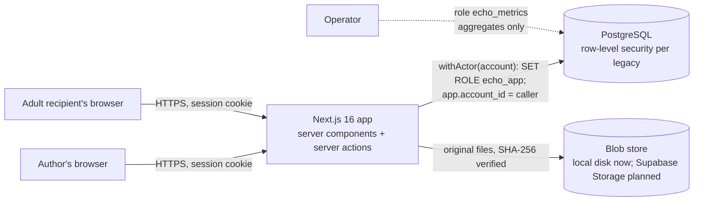

# Echo of Me | 03 Technical Architecture and Engineering

| Field | Value |
|---|---|
| Document ID | 03 |
| Version | v1.1 (v1.0 kept unchanged; this version adds ADR-012 rate limits and ADR-013 account rights) |
| Date | 19 November 2026 |
| Status | **Describes what is built and tested** on `main` (local only). Consolidates ADR-001…013. Where something is planned rather than built, it says so. |
| Evidence | Code in `QuintessenceIntelligence/echo-of-me`; test results in `tests/results/` (mirrored in `canonical/build/`) |

## 1. Shape of the system

- **One web application** (Next.js 16, React 19, TypeScript, Node 22). Pages are server components; changes go through server actions; two route handlers stream files (`/media/[assetId]`, `/legacy/export/download`). (ADR-001, ADR-002)
- **One database** (PostgreSQL 16 locally, 17 on Supabase). **Every row belongs to a legacy**, and row-level security decides who may see it, on every query. The application connects as a least-privilege login that can do nothing until it assumes `echo_app` for the signed-in person. (ADR-003, ADR-005, DR-057)
- **No AI provider, no third-party processing.** Answers quote the author's approved words; theme suggestions use a local keyword list. (ADR-007a, DR-054 R0)

## 2. Code layout

| Path | What it holds |
|---|---|
| `app/` | Pages: landing, sign-in, MFA, onboarding, legacy dashboard, memories, practice (`rehearse`), prompts, reports, activity, export, delete, recipient `shared/[legacyId]`, invitation, `account` (your account, download your data, leave, close); `vault-actions.ts`, `actions.ts` and `account-actions.ts` (server actions); `ui/AnswerView.tsx` (one answer display for authors and recipients) |
| `src/domain/` | Business rules: `onboarding`, `consent`, `vault` (capture, provenance, versions, media, transcripts, tags), `rehearsal` (answer pipeline, answer rules, recipient questions), `safety`, `sharing` (grants, recipient view, reports), `prompts`, `export`, `deletion`, `progress`, `limits` (rate limits), `account` (personal-data rights), `audit`, `errors` |
| `src/server/` | `db` (`withActor`, `withSystem`), `session`, `auth-mode`, `storage` (blob stores), `zip`, `same-origin`, `migrate` |
| `db/migrations/` | 0001–0014 (below); `db/seed/` consent texts v0.1-draft, guided prompts v0.1-draft |
| `proxy.ts` | Per-request Content-Security-Policy with nonces |
| `tests/` | vitest on real PostgreSQL (unit, database, isolation, evaluation), `eval/` answer sets, `e2e/` Playwright walkthroughs with axe-core, `results/` |

## 3. Data model (by migration)

| Migration | Adds |
|---|---|
| 0001 | `account`, `legacy` (lifecycle states), `recipient` (minors are records only), `invitation` (hashed single-use tokens), `trusted_contact`, versioned `consent_document` + append-only `consent_event`, append-only `audit_event`; owner-only RLS |
| 0002–0005 | `echo_app_login` (NOINHERIT) + `app.provision_account()`; Supabase Data API roles closed; verification role; pinned function search paths |
| 0006 | `memory_item` + append-only `memory_version`; immutable `media_asset` (SHA-256, server-generated keys); `transcript` + append-only `transcript_version`; `memory_tag`; `memory_audience` (intent only); **`citable_source` view** |
| 0007, 0009 | `app.search_citable()` (the only search entry point), `app.adjacent_memories()`, `app.question_terms()`; `rehearsal_turn` |
| 0008 | `answer_rule` (pin / suppress, keyed by topic words) |
| 0010 | `share_grant`; `app.shared_with_me()` and helpers; recipient read policies; `recipient_turn` (private); `answer_report` |
| 0011 | `prompt` (editorial, immutable text), `memory_item.prompt_id`, `prompt_dismissal` |
| 0012 | `app.pilot_metrics()` for the NOLOGIN role `echo_metrics` |
| 0013 | `rate_limit` counters (no application access) and `app.rate_limit_hit()` (ADR-012) |
| 0014 | `app.set_actor()` (refuses closed or unknown accounts on every request), `app.leave_legacy()`, `app.close_my_account()`; invitation status `left`; `account.closed_at` with an anonymisation constraint; application role can no longer update accounts (ADR-013) |

Integrity rules enforced **in the database**, not only in code: composite foreign keys `(id, legacy_id)` so nothing can point across legacies; triggers making versions, originals, consent events and the audit log immutable; check constraints tying approval to the exact current version; safety questions stored without text.

## 4. Security model

### 4.1 Who can see what
| Caller | Can read | Enforced by |
|---|---|---|
| Author | Everything in their own legacies | RLS `app.owns_legacy()` |
| Adult recipient (accepted) | Only items shared with them that are **currently approved**, their **current** version, originals and **approved** transcripts; nothing else | RLS policies calling `app.shared_with_me()` (grant + accepted adult + active legacy + approved + sensitive confirmed + author's sharing consent), re-checked on every read |
| Another family | Nothing | RLS; "not found" responses; refusals audited |
| No session | Nothing | RLS (no `app.account_id`) |
| Closed or unknown account | Nothing | `app.set_actor()` refuses to start the request |
| Operator | Aggregate pilot numbers only; no tables | `echo_metrics` role (execute one function) |

Adversarial test suites run every operation as another family, as a recipient, as a closed account and with raw SQL as the application role: **0 successes** across slices 1–6 and ADR-012/013.

### 4.2 Authentication (current vs planned)
- **Now:** development sign-in and a simulated second factor (`AUTH_MODE=dev`), automatically refused on any hosted deployment. Actions that expose or destroy data (invite, share, export a legacy, download your own data, delete an item or a legacy, close an account) require the second factor.
- **Planned (ADR-004):** Supabase Auth with email and TOTP; needs the founder's connector switch.

### 4.3 Web security
- Strict per-request **Content-Security-Policy** (nonce + `strict-dynamic`; no inline scripts or styles; `object-src 'none'`; `frame-ancestors 'none'`; HSTS and HTTPS upgrade when hosted).
- `Referrer-Policy: no-referrer` (invitation tokens), `X-Content-Type-Options`, `X-Frame-Options`, `Permissions-Policy` (microphone for this site only).
- Server actions use Next.js origin checks; the export download checks `Sec-Fetch-Site`.
- Uploads: type decided from the bytes (audio and PNG/JPEG/WebP only; SVG and video refused), size limits, quota; files served with `nosniff`, sandboxing CSP and `no-store`.
- **Per-account rate limits** counted in Postgres before the action (questions, recipient questions, uploads, invitations, exports, reports); failed attempts count; first refusal per window logged (ADR-012).
- Secrets are never committed; `.env.example` lists names only.

### 4.4 Privacy by design
Questions recipients ask are private to them. The author's activity log records actions with identifiers and counts, never content. Consent withdrawal takes effect immediately (invitations cancelled, sharing stopped, pending suggestions removed). Export gives everything in open formats; deletion removes everything except the consent history and the minimised log. Every account can download its own data, recipients can leave a legacy, and anyone can close their account (anonymised; authors delete their legacy first) (ADR-013). Full governance in doc 05 v0.1. ⚖ Legal review pending (consent texts v0.1-draft).

## 5. Provenance and answers

| Provenance | Meaning | Citable |
|---|---|---|
| P1 | Original recording or photo, byte-identical | Yes (when the item is approved) |
| P2 | Author's own words | Yes (approved, current version) |
| P3 | Transcript the author approved | Yes |
| P4 / P5 | Approved AI summary / family contributor | Reserved |
| P6 | Unapproved machine output (transcript, suggestion) | **Never** |

Answer pipeline (`composeAnswer`): crisis screen → identity / role-play screen → topic words → author rules (pin / suppress) → `app.search_citable` over `citable_source` → evidence class **E1** (in their own words), **E2** (related, not direct) or **E3** (not recorded, with adjacent memories) → verbatim quotes with citations → private turn record + audit. The same pipeline serves author practice and recipients; the database decides what each caller can see. Quality is measured by `tests/evaluation.test.ts` (100 questions over two synthetic sets; gates: no leakage, verbatim quotes, 100 % crisis and identity routing, ≥ 90 % abstention).

## 6. Storage
- `BlobStore` interface; `LocalBlobStore` for development and tests (refused when hosted). Keys are `<legacy uuid>/<asset uuid>`; writes are atomic; every write is read back and every read is checked against the stored SHA-256 and size.
- **Planned:** Supabase Storage adapter (private bucket, server-side only, signed direct uploads because Vercel limits request bodies to 4.5 MB).

## 7. API surface (server actions and routes)
All writes are server actions in `app/actions.ts`, `app/vault-actions.ts` and `app/account-actions.ts`, each delegating to one domain function that validates input (zod), checks ownership/consent/MFA inside an RLS transaction, and writes an audit event (refusals are audited in a separate transaction). Three routes stream files (media, legacy export, account data). There is no public JSON API.

## 8. Testing and quality
| Layer | Tool | Current result |
|---|---|---|
| Domain + database (real PostgreSQL, fresh database per file) | vitest | **124/124** |
| Cross-family and recipient isolation (incl. raw SQL as the app role) | vitest | 0 successful attacks |
| Answer quality | evaluation sets v1.0 + v1.1 held-out | all gates green |
| End-to-end in a real browser (incl. fake microphone, two-person flows) | Playwright, 8 walkthroughs | **101/101 steps**, with CSP active |
| Accessibility | axe-core (WCAG 2.0–2.2 A/AA) on every main screen | 0 violations (automated only) |
| Mutation checks | deliberate breakages | slices 2, 3a, 4 and ADR-013 (2 of 2) detected; slice 5 not run (blocked by the automated safety system) |
| CI | GitHub Actions workflow | committed, **manual trigger only**, not yet run |

## 9. Environments and deployment
| Environment | State |
|---|---|
| Local | Full stack, synthetic data |
| Supabase dev database (eu-west-1) | Migrations 0001–0005 applied; **0006–0014 + seed 0002 pending** (founder's connector switch) |
| Vercel (Hobby, non-commercial, DR-056) | Nothing deployed; preview-only plan once real sign-in and storage exist |

## 10. Known gaps before a hosted pilot
1. Real sign-in with TOTP (Supabase Auth) and session hardening.
2. Supabase Storage adapter and signed uploads.
3. ~~Rate limiting~~ per-account limits built (ADR-012); sign-in limits come with Supabase Auth; per-IP limits at the hosting layer when deployed.
4. Backups (the free plan has none) and a restore drill.
5. Malware scanning of uploads (types are restricted; files are never executed).
6. Legal review of consent texts and the safety wording ⚖ ⚕.
7. AI provider decision (ADR-007) if generated (non-quoted) answers or automatic transcription are wanted.
8. When real sign-in exists, closing an account must also delete the identity-provider user (ADR-013).
9. Go / no-go list for any real personal data: doc 05 §13.
